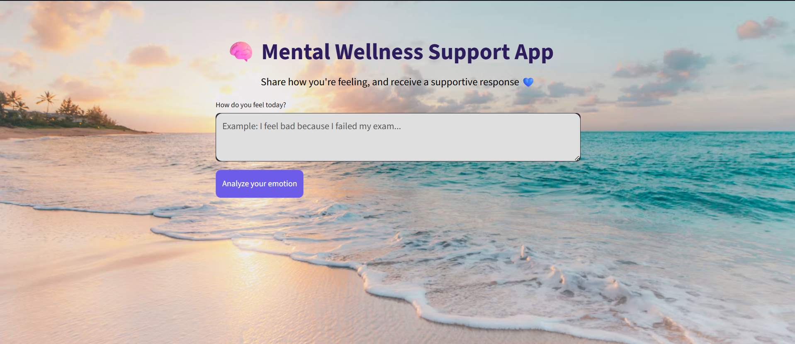
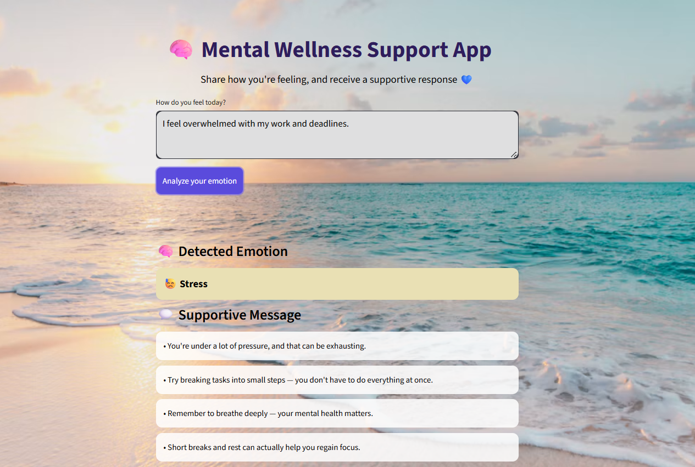
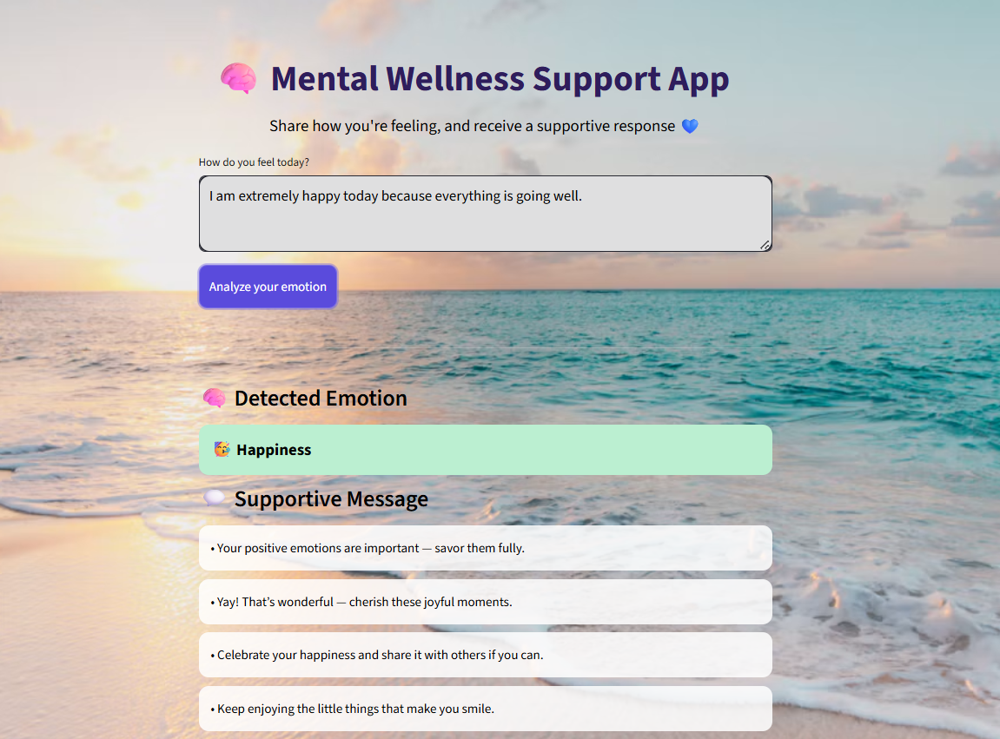
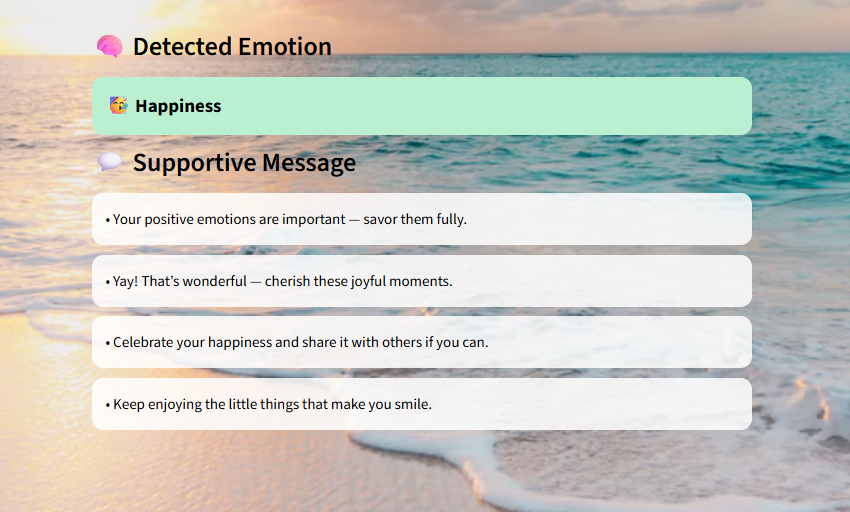

# Mental Wellness & Supportive Response System Using NLP 🧠

### An NLP and Machine Learning-Based Application for Emotion Detection and Supportive Response Generation

## Introduction

The Mental Wellness & Supportive Response System is a Python-based application developed using Natural Language Processing (NLP) and Machine Learning. It analyzes user-provided text, identifies the emotion expressed, and generates supportive messages based on the detected emotion.

The project demonstrates how NLP techniques and Machine Learning algorithms can be used to perform basic emotion classification through an interactive web application.

## What the Project Demonstrates

- **Text Preprocessing:** Cleaning and preparing text for analysis.
- **TF-IDF Vectorization:** Converting text into numerical features based on word importance.
- **Emotion Classification:** Predicting emotions using the Multinomial Naive Bayes algorithm.
- **Supportive Response Generation:** Displaying predefined supportive messages based on the predicted emotion.
- **Interactive Interface:** Providing a simple user experience through Streamlit.

## How It Works

1. **User Input:** The user enters a sentence describing their feelings or experience.
2. **Text Preprocessing:** The input text is prepared for analysis.
3. **Feature Extraction:** TF-IDF Vectorization converts the text into numerical features.
4. **Emotion Prediction:** The trained Multinomial Naive Bayes model predicts the emotion.
5. **Response Generation:** The application selects supportive messages corresponding to the predicted emotion.
6. **Output Display:** The detected emotion and supportive messages are displayed through Streamlit.

## Emotions Detected

The application supports nine emotion categories:

- Stress
- Anxiety
- Sadness
- Anger
- Fear
- Depression
- Loneliness
- Happiness
- Neutral

## Technologies Used

| Technology | Purpose |
|---|---|
| Python | Core programming language |
| Streamlit | Web application interface |
| NLTK | Text preprocessing |
| Pandas | Dataset handling |
| NumPy | Numerical operations |
| Scikit-learn | Machine Learning |
| TF-IDF | Feature extraction |
| Multinomial Naive Bayes | Emotion classification |
| Pickle | Saving and loading trained objects |

## Project Structure

```text
Mental-Wellness-and-Supportive-Response-System-Using-NLP/
│
├── data/
│   └── mental_health_data.csv
│
├── screenshots/
│   ├── home_page.png
│   ├── stress_detection.png
│   ├── happiness_detection.png
│   └── supportive_response.png
│
├── app.py
├── preprocess.py
├── train.py
├── predict.py
├── mental_wellness_model.pkl
├── tfidf_vectorizer.pkl
├── requirements.txt
└── README.md
```

## How to Run the Project Locally

**1. Clone the repository**

```bash
git clone https://github.com/athulya-p08/Mental-Wellness-and-Supportive-Response-System-Using-NLP.git
```

**2. Navigate to the project directory**

```bash
cd Mental-Wellness-and-Supportive-Response-System-Using-NLP
```

**3. Create a virtual environment**

```bash
python -m venv venv
```

**4. Activate the virtual environment (Windows)**

```bash
venv\Scripts\activate
```

**5. Install dependencies**

```bash
pip install -r requirements.txt
```

**6. Run the application**

```bash
streamlit run app.py
```

The application will open in your browser at:

`http://localhost:8501`

## Application Screenshots

### 1. Home Page



### 2. Stress Detection



### 3. Happiness Detection



### 4. Supportive Response



## Limitations

- The model's performance depends on the size and quality of the training dataset.
- Predictions may not always accurately represent complex emotions or contextual meaning.
- Supportive messages are predefined and selected based on the predicted emotion.
- The system is not designed to provide clinical assessments or medical diagnoses.

## Disclaimer

This project is developed for educational purposes to demonstrate the use of Natural Language Processing and Machine Learning in emotion classification.

The predicted emotions are not psychological or medical diagnoses, and the application does not replace professional mental health support.

## About

Developed as an academic project exploring Natural Language Processing, Machine Learning, emotion detection, and supportive response generation.